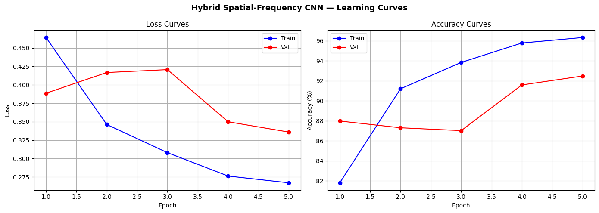

# Hybrid Deepfake Detection: Spatial-Frequency CNN with Attention

A binary real/fake classifier for face images, trained on FaceForensics++ C23. The project asks whether two additions to a MobileNetV2 detector help: a learned feature gate (called "attention" in version 1) and a frequency branch that reads the FFT magnitude spectrum.

1. **Baseline:** ImageNet-pretrained MobileNetV2 with a 2-way head.
2. **Attention CNN / gate:** the same backbone with a learned 1×1 convolution + sigmoid gate on its feature map.
3. **Hybrid Spatial-Frequency CNN:** the gate model plus a small CNN on the log-scaled FFT magnitude spectrum, with a dense fusion head.

## Status

**Version 2 did not get the expected results.** The expected result was a hybrid model that clearly beats a plain MobileNetV2 baseline. Under a controlled comparison (the same training for every model, an identity-disjoint split, three training seeds), neither the gate nor the FFT branch gave a robust improvement. The gains that version 1 reported (+2.44 points for attention and +4.25 for the hybrid, one run each) came from models trained with different budgets, and they did not hold up.

**Version 3 is planned.** It has not started. Directions under consideration, not commitments: train longer (9 of the 12 version 2 runs were still improving at epoch 5), redesign the frequency branch so it keeps frequency position, try a stronger backbone, and test on another dataset (Celeb-DF or DFDC).

## The notebooks

| Version | File | What it is | Status |
|---|---|---|---|
| 1 | `DEEPLEARNING.ipynb` | Baseline and attention models, one run each, on the Kaggle split | Numbers are real. The explanations in its text were never tested, and the attention gain does not hold on the balanced test subset |
| 1 | `Hybrid Deepfake.ipynb` | Hybrid model, one run | Measures 92.84% test accuracy. The 93.34% in its text was typed by hand and is not produced by the code |
| 2 | `Deepfake_Detection_v2_kaggle.ipynb` | Runnable matched study: four variants × three seeds on an identity-disjoint split, plus a report | Ran end to end on a Kaggle T4 |
| 2 | `Deepfake_Detection_v2_full_run.ipynb` | The same notebook with the outputs of the full run and its report | Result: no robust gain from either component |
| 3 | not yet | Planned | |

The version 1 notebooks are unchanged. Their text still contains claims that the tables below correct.

## Version 2: matched ablation on an identity-disjoint split

### What changed from version 1

- **One protocol for all four variants** (gate off/on × FFT off/on): the same data, epochs, loss, scheduler and dense head. A fresh balanced real/fake subset is drawn every epoch.
- **An identity-disjoint split.** In the Kaggle split, 229 of the 295 test identities (original videos and actors) also appear in training. The clean split has none. DeepFakeDetection is excluded because it has no real frames from its own studio domain and its actors cannot be split cleanly.
- **Three training seeds per variant**, 12 runs in total, about 4 hours on a Kaggle T4.
- **Metrics that ignore the class split** (AUC and balanced accuracy), video-level decisions, and 95% intervals from resampling test videos.
- **67 automated tests** for the metrics, the split, the models and the report.

| | Original Kaggle split | Clean split (seed 0) |
|---|---|---|
| Frames train / val / test | 128,477 / 27,493 / 26,276 | 109,304 / 23,373 / 23,404 |
| Identities shared between splits | train/val 218, train/test 229, val/test 65 | 0, 0, 0 |
| Test identities also seen in training | 229 of 295 | 0 of 142 |
| Fake share of test frames | 85.0% | 83.1% |

### Results

Test set: 23,404 frames from 818 videos (139 real, 679 fake). Always answering "fake" scores 83.11% per frame, so accuracy is only meaningful against that. Mean ± standard deviation over 3 seeds.

| Model | Frame AUC | Video AUC | Frame balanced acc @0.5 | Frame accuracy @0.5 | Video accuracy @0.5 |
|---|---:|---:|---:|---:|---:|
| Baseline | 0.9714 ± 0.0011 | 0.9862 ± 0.0010 | 91.55 ± 0.55 | 91.74 ± 1.03 | 94.78 ± 0.98 |
| + Gate | 0.9695 ± 0.0006 | 0.9861 ± 0.0010 | 91.48 ± 0.38 | 92.60 ± 0.57 | 94.95 ± 0.51 |
| + FFT | 0.9694 ± 0.0040 | 0.9853 ± 0.0022 | 91.72 ± 0.32 | 91.69 ± 1.36 | 94.50 ± 1.17 |
| Gate + FFT (hybrid) | 0.9724 ± 0.0022 | 0.9889 ± 0.0010 | 91.74 ± 0.93 | 90.14 ± 2.70 | 93.89 ± 1.62 |

Test AUC for each seed (frame level):

| Model | Seed 0 | Seed 1 | Seed 2 |
|---|---:|---:|---:|
| Baseline | 0.9707 | 0.9727 | 0.9708 |
| + Gate | 0.9694 | 0.9702 | 0.9690 |
| + FFT | 0.9729 | 0.9704 | 0.9651 |
| Gate + FFT | 0.9720 | 0.9747 | 0.9704 |

The full report is in [`results/v2/report.md`](results/v2/report.md), with the figures [`roc_frame.png`](results/v2/roc_frame.png), [`per_manipulation_auc.png`](results/v2/per_manipulation_auc.png) and [`learning_curves.png`](results/v2/learning_curves.png). The summary at the top of that report lists AUC effects only. The balanced-accuracy effects, including the gate's loss below, are in its section 4. The package now includes them in the summary, so a new report run will show them there.

### What the results say

- **The baseline is strong, and nothing clearly beats it.** All four variants are within about 0.003 AUC of each other, which is about the size of the spread between seeds.
- **Every effect against the baseline is unresolved on frame AUC.** Gate −0.0018 [−0.0043, +0.0004], FFT −0.0019 [−0.0044, +0.0006], gate + FFT +0.0010 [−0.0016, +0.0041] (95% intervals from resampling test videos).
- **The gate lowers video-level balanced accuracy** by 1.43 points [−2.78, −0.30] against the baseline. This is the one clear loss in the report.
- **Only the gate × FFT interaction excludes zero** (+0.0048 frame AUC [+0.0011, +0.0087]). That is weak evidence: the report makes 24 comparisons, and with that many, an isolated interval excluding zero is often chance.
- **The FFT branch is the least stable.** Its three seeds range from 0.9651 to 0.9729 test AUC, and its detection rate at 1% false positives varies by ±12 points.
- **NeuralTextures is the hardest manipulation** (AUC about 0.93, against 0.97 to 0.99 for the others).
- **Accuracy at threshold 0.5 is unstable across seeds** (hybrid ±2.70). Balanced accuracy at a threshold chosen on validation data is 91.8% to 92.0% for all four variants.
- **Training had not converged.** 9 of 12 runs had their best validation AUC in the last epoch.

### What the results do not say

- Nothing was tested on another dataset. A detector trained on one dataset often drops sharply on others, so these numbers say little about real-world use.
- The intervals measure test-set uncertainty only. Training randomness is what the ± values estimate, and three seeds is too few to estimate it well.
- The frequency branch is the original design: it ends in global average pooling, which throws away frequency position, and it reads 224×224 JPEG crops after resizing and augmentation. A null result here says this design does not help, not that frequency cues cannot.
- Five epochs and one learning rate for every variant. A longer run, or a different learning rate for the added components, could change the ranking.

### Running version 2

Use `Deepfake_Detection_v2_kaggle.ipynb`: import it into a Kaggle notebook, set Accelerator to GPU T4 and Internet to On, add the FaceForensics++ C23 dataset with **+ Add Input**, and run the cells top to bottom. It reads the dataset in place, so no download or key is needed. Start with `SEEDS = [0]` (four runs), then use `[0, 1, 2]`. Details, the package layout and the tests are in [`deepfake_v2/README.md`](deepfake_v2/README.md).

## Version 1: single-run results

These are the numbers the version 1 notebooks actually produce, on the dataset's own validation and test splits.

| Model | Val acc | Test acc | Test AUC-ROC | Balanced test acc |
|---|---:|---:|---:|---:|
| Baseline MobileNetV2 | 87.52% | 88.59% | not computed | 86.80% (6,000-image subset) |
| Attention CNN | 90.78% | 91.03% | not computed | 85.10% (6,000-image subset) |
| Hybrid Spatial-Frequency CNN | 92.47% | 92.84% | 0.9748 | ≈92.2% (full test set, from confusion matrix) |

The test set has 26,276 images, of which 3,944 are real and 22,332 are fake. The "Balanced test acc" column uses a different test subset for the first two rows, so compare it with care.

**Hybrid per-class results** (test set, `sklearn.classification_report`):

| Class | Precision | Recall | F1 | Support |
|---|---:|---:|---:|---:|
| Real (0) | 0.70 | 0.91 | 0.79 | 3,944 |
| Fake (1) | 0.98 | 0.93 | 0.96 | 22,332 |
| **Accuracy** | | | **0.93** | 26,276 |

Confusion matrix for the hybrid model on the test set:

| | Predicted Real | Predicted Fake |
|---|---:|---:|
| **Actual Real** | 3,596 | 348 |
| **Actual Fake** | 1,533 | 20,799 |

Real precision is the weakest figure, but it comes mainly from the test set's composition. About 85% of the test set is fake, so the 1,533 fakes the model calls real are compared against only 3,596 correctly identified reals. Real recall (0.91) and fake recall (0.93) are close, so at threshold 0.5 the model treats the two classes about equally.

### The version 1 ablation is not controlled

The three models were not trained under the same conditions:

| | Baseline | Attention CNN | Hybrid |
|---|---|---|---|
| Notebook | `DEEPLEARNING.ipynb` | `DEEPLEARNING.ipynb` | `Hybrid Deepfake.ipynb` |
| Training images | 10,000 (5,000 per class) | 10,000 (5,000 per class) | 36,782 (18,391 per class) |
| Epochs | 3 | 3 | 5 |
| Loss | cross-entropy | cross-entropy | cross-entropy, label smoothing 0.1 |
| LR schedule | none | none | ReduceLROnPlateau |
| Optimizer | Adam, lr 1e-4 | Adam, lr 1e-4 | Adam, lr 1e-4 |

Because of these differences, the hybrid's gains cannot be attributed to the architecture. On the measured test set the differences are +2.44 points for attention over baseline, +4.25 points for the hybrid over baseline, and +1.81 points for the hybrid over attention. Version 2 is the controlled comparison.

On the balanced test subset, the attention model scores 1.70 points below the baseline (85.10% against 86.80%). The attention gain does not hold up under balanced evaluation. The hybrid was not evaluated on that subset, so its balanced accuracy above is computed from its confusion matrix on the full test set.

### Discrepancies between the version 1 documents and the notebooks

| Claim | Where | What the notebook measures |
|---|---|---|
| Hybrid test accuracy 93.34%, val 92.83% | Original proposal (since removed); markdown and chart in the hybrid notebook | Test 92.84%, val 92.47% (cell 31). The ablation chart uses hard-coded values |
| Real precision 0.74 | Original project PDF (since removed); markdown in the hybrid notebook | 0.70 (classification report) |
| Fake precision 0.97, recall 0.95 | Summary cell 40 in the hybrid notebook | 0.98 and 0.93 (classification report) |
| FFT branch adds +2.31% over attention | Summary cell 40 in the hybrid notebook | +1.81 points using measured numbers (92.84 − 91.03), and the two were trained with different budgets |
| Balanced subset redrawn each epoch | Original project PDF | Drawn once with seed 42 (cell 13). Version 2 redraws it every epoch |
| Grad-CAM for the hybrid model | Original project PDF | Grad-CAM code exists only for the attention model, in `DEEPLEARNING.ipynb`, and it was only viewed by eye |

Where the documents disagree with the notebook outputs, treat the notebook outputs as the reference.

## Architecture

Input: 224×224 RGB face crop, ImageNet mean/std normalization.

**Spatial branch**
- MobileNetV2 `features` (ImageNet weights, all layers fine-tuned), producing a 1280×7×7 feature map.
- Gate: 1×1 convolution (1280→1280) followed by a sigmoid. The output is multiplied element-wise with the feature map.
- Global average pooling gives a 1280-d vector.

The gate is computed per position and per channel. It is a learned spatial-channel gate, not squeeze-and-excitation channel attention. What it learns has not been measured.

**Frequency branch** (hybrid only)
- Average the RGB channels to grayscale.
- 2D FFT, `fftshift`, magnitude, `log1p`, then per-image min-max normalization to a 1×224×224 tensor.
- Three conv blocks, channels 1→16→32→64, each Conv3×3 → BatchNorm → ReLU. Max-pooling follows the first two blocks.
- Global average pooling gives a 64-d vector.

**Fusion and head**
- Concatenate: 1280 + 64 = 1344 (hybrid) or 1280 (no frequency branch).
- Linear(1344→256) → ReLU → Dropout(0.4) → Linear(256→64) → ReLU → Dropout(0.3) → Linear(64→2).
- In version 2 every variant uses this same dense head. The version 1 baseline used a single Linear(1280→2).

## Data

- **Source:** Kaggle dataset `gradientvoyager/faceforensics-c23-extracted-faces-100k` (about 2.46 GB). The Kaggle CLI reports its license as CC-BY-NC-SA-4.0. The data is not included in this repository.
- **Classes:** seven folders: `DeepFakeDetection`, `Deepfakes`, `Face2Face`, `FaceShifter`, `FaceSwap`, `NeuralTextures`, `Real`. Binary labels: `Real` = 0, all others = 1.
- **Splits (original):** `dataset_processed_split/{train,val,test}` contains 128,477, 27,493, and 26,276 images. The dataset also includes `dataset_manifest.csv`, which lists every image with its source ID, frame index, label, manipulation type, and split. Version 2 recomputes an identity-disjoint split from this manifest.

| Class | Train | Val | Test |
|---|---:|---:|---:|
| Real | 18,391 | 4,109 | 3,944 |
| Deepfakes | 18,085 | 4,017 | 3,875 |
| Face2Face | 18,365 | 4,105 | 3,954 |
| FaceShifter | 17,481 | 3,889 | 3,715 |
| FaceSwap | 18,885 | 4,209 | 4,044 |
| NeuralTextures | 17,390 | 3,879 | 3,744 |
| DeepFakeDetection | 19,880 | 3,285 | 3,000 |

**Filenames.** Each filename starts with the source video ID, which matches `source_id` in the manifest. Manipulated images have a second numeric ID, and both IDs matter for splitting: the same pair appears once per manipulation method.

**Effective sample size.** The images come from few source videos. The original training split has 674 source IDs, and the validation and test splits have 149 and 147. The number of independent samples is much smaller than the image count.

### Leakage in the original split

Source IDs never overlap across the original three splits, but the second ID of a manipulated video does. Version 1 found that 106 of the 147 test source IDs appear as the target of a manipulated video in the training split. Version 2 measured it over all identities: 229 of the 295 test identities also appear in training. A manipulated video's target is the footage the source face is pasted onto, so the training set can contain footage of people who also appear in the test reals. That is a plausible route to inflated test accuracy. The clean split in version 2 removes it, but the effect of the leakage on version 1 accuracy has not been measured.

## Version 1 training

### Hybrid (`Hybrid Deepfake.ipynb`)

| Setting | Value |
|---|---|
| Epochs | 5 |
| Batch size | 32 |
| Optimizer | Adam, lr = 1e-4 |
| Loss | CrossEntropyLoss, label smoothing 0.1 |
| Scheduler | ReduceLROnPlateau on validation accuracy (mode = max, patience = 1, factor = 0.5) |
| Train augmentation | Resize 224, RandomHorizontalFlip, RandomRotation ±10°, ColorJitter (0.2 brightness/contrast/saturation) |
| Val/test transforms | Resize 224 and ImageNet normalization only |
| Checkpoint | Saved whenever validation accuracy improves |

Per-epoch results from the saved output:

| Epoch | Train loss | Train acc | Val loss | Val acc |
|---:|---:|---:|---:|---:|
| 1 | 0.4642 | 81.81% | 0.3887 | 87.98% |
| 2 | 0.3462 | 91.20% | 0.4167 | 87.31% |
| 3 | 0.3080 | 93.83% | 0.4207 | 87.02% |
| 4 | 0.2763 | 95.77% | 0.3499 | 91.58% |
| 5 | 0.2671 | 96.32% | 0.3359 | 92.47% |

Validation accuracy was still rising at epoch 5.



### Baseline and attention (`DEEPLEARNING.ipynb`)

Both models use Adam (lr 1e-4), plain cross-entropy, batch size 32, and 3 epochs on the 10,000-image balanced subset. Training accuracy after epoch 3 was 96.18% (baseline) and 96.50% (attention).

## Repository contents

- `DEEPLEARNING.ipynb`: version 1, baseline and attention models, including the Grad-CAM figures for the attention model. Its introduction refers to the hybrid notebook as "Deepfake Research Extension.ipynb"; in this repository that is `Hybrid Deepfake.ipynb`.
- `Hybrid Deepfake.ipynb`: version 1, the hybrid model pipeline (data, balanced sampling, FFT transform, model, training, evaluation, plots, weight saving).
- `Deepfake_Detection_v2_kaggle.ipynb`: version 2, the runnable matched study for Kaggle.
- `Deepfake_Detection_v2_full_run.ipynb`: version 2, the same notebook with the outputs of the full run (12 runs) and its report.
- `deepfake_v2/`: the version 2 package (`dfv2/`), its tests, its README, and `build_notebook.py`, which generates the version 2 notebooks from the package.
- `results/v2/`: the version 2 report and figures.
- `docs/learning_curves_hybrid.png`: training and validation curves from the version 1 hybrid run.
- `.gitignore`: keeps the dataset, zip archives, run outputs and model weights out of the repository.

Not in this repository: the dataset and the trained weights.

## Setup

**Version 2 (Kaggle):** see "Running version 2" above. The Kaggle environment already has PyTorch, torchvision, scikit-learn, pandas and matplotlib.

**Version 1 (Colab layout):**

Both notebooks fall back to CPU if CUDA is unavailable, but training will be very slow. Install:

```bash
pip install torch torchvision scikit-learn matplotlib seaborn numpy pandas kaggle grad-cam
```

**Kaggle credentials (version 1 only).** Set your credentials as environment variables or in Colab Secrets. Do not put a key in a notebook, and do not commit one. Both notebooks check that the variables are set and stop with a message if they are not.

```bash
export KAGGLE_USERNAME="your_username"
export KAGGLE_KEY="your_api_key"
```

An earlier version of `Hybrid Deepfake.ipynb` contained a hard-coded Kaggle key. If you cloned the repository before commit `cea5562`, revoke that key on Kaggle.

**Data paths (version 1).** Both notebooks expect the Colab layout `/content/dataset/dataset_processed_split/{train,val,test}`, set as `data_dir`. For a local run, change that path to where you unzip the dataset.

**Running the version 1 hybrid notebook** (`Hybrid Deepfake.ipynb`): set the credentials, run the download and unzip cells (6–7), data and loader cells (9–17), model cells (19–20), training cells (22–25) and evaluation cells (31, 36–38), then save the weights (cell 42). Outputs: `best_hybrid_model.pth`, `hybrid_deepfake_model.pth`, `hybrid_training_curves.png`, `roc_curve.png`, `ablation_study.png` (the last uses hard-coded numbers).

**Running the version 1 baseline and attention notebook** (`DEEPLEARNING.ipynb`): set the credentials, then run the cells in order through cell 37. Cells 31–34 produce the Grad-CAM figures.

## Limitations

- **Version 2 did not reach the expected results.** No robust gain from the gate or the FFT branch.
- **One dataset.** Training and testing use FaceForensics++ C23 only. Generalization to DFDC or Celeb-DF is untested and is likely to be much lower.
- **Version 1 is confounded and its split leaks.** See the version 1 sections.
- **DeepFakeDetection is excluded** from version 2, so version 2 results say nothing about it.
- **Few independent samples.** The version 2 test set has 818 videos, and the frames within a video are nearly copies of each other. The intervals resample whole videos for that reason.
- **Three seeds and five epochs.** The spread estimates are rough, and most runs had not converged.
- **Compressed source data.** C23 is compressed video. A detector can partly learn compression artifacts, and other compression levels are untested.
- **Frequency branch design.** It is the original design and it pools away frequency position. See above.
- **Weights not included.** The trained model files are not in this repository.
- **Not a security tool.** This is a research prototype. Do not use it for real-world authenticity decisions.

## License

No license file is included with the code, so the code's license has not been specified. The dataset is licensed CC-BY-NC-SA-4.0 by its Kaggle listing.
